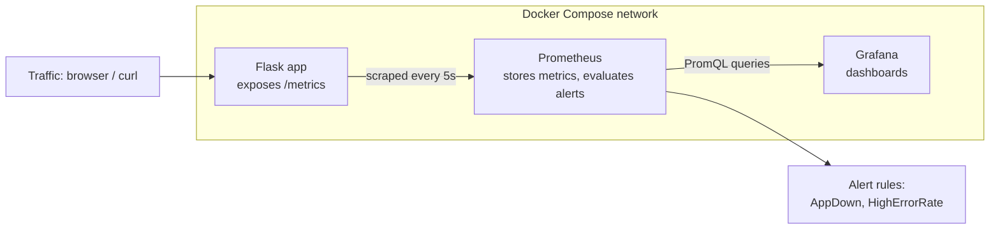
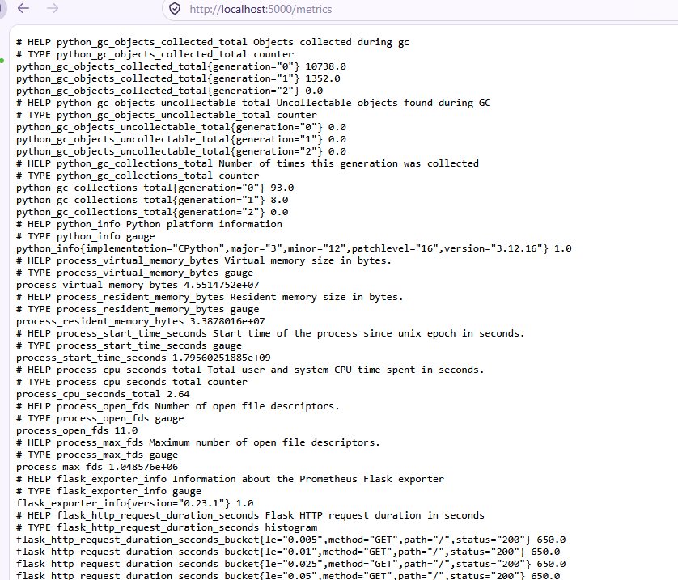
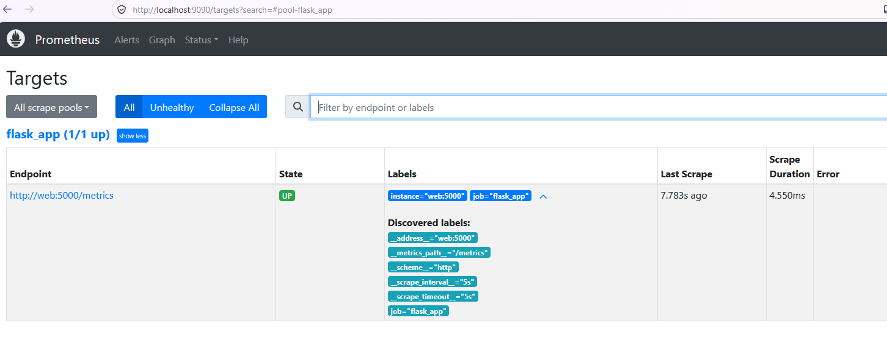
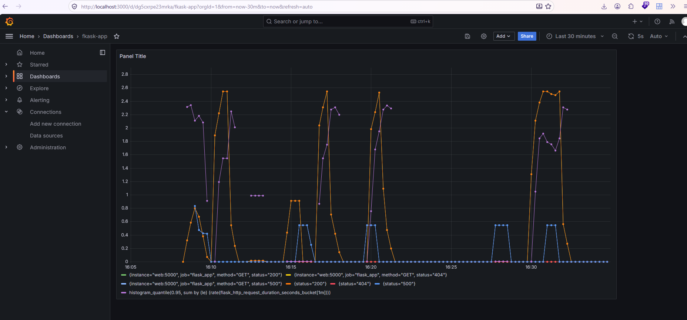
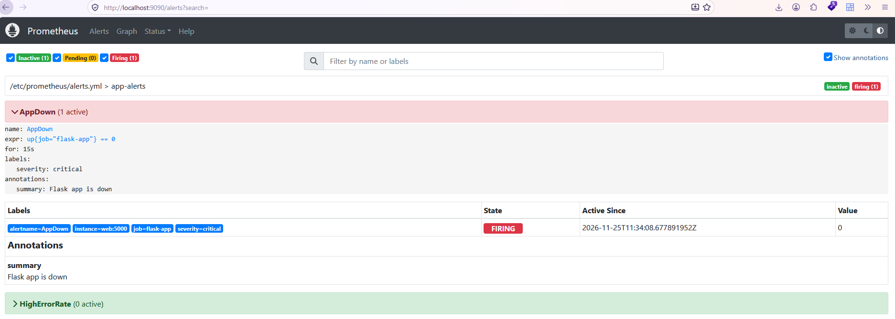

# Monitoring a Flask App with Prometheus and Grafana

A Flask application that exposes metrics, a Prometheus server that collects them, and a Grafana dashboard that visualises them. Alert rules in Prometheus fire when the app goes down or starts returning errors. Everything runs locally with Docker Compose.

## How it works



1. **Flask** counts requests, durations, and errors, and publishes them as text at `/metrics` (using `prometheus-flask-exporter`).
2. **Prometheus** scrapes `/metrics` every 5 seconds, stores the values as time series, and evaluates the alert rules.
3. **Grafana** queries Prometheus with PromQL and draws the results as panels.

| Service | Image | Port | Role |
|---------|-------|------|------|
| `web` | Built from `Dockerfile` | 5000 | Flask app with a `/metrics` endpoint |
| `prometheus` | `prom/prometheus:v2.54.1` | 9090 | Metrics storage and alerting |
| `grafana` | `grafana/grafana:11.2.0` | 3000 | Dashboards |

## Application endpoints

| Endpoint | Purpose |
|----------|---------|
| `/` | Normal request |
| `/slow` | Responds after a random 0.2 to 1.5 second delay, used to create latency |
| `/error` | Always returns HTTP 500, used to trigger the error alert |
| `/health` | Health check |
| `/metrics` | Prometheus metrics |

`/slow` and `/error` exist so the dashboard and alerts have something interesting to show.

## Project structure

```
monitoring-prometheus-grafana/
├── app.py                          # Flask app with Prometheus metrics
├── requirements.txt
├── Dockerfile
├── docker-compose.yml              # web + prometheus + grafana
├── prometheus.yml                  # Scrape configuration
├── alerts.yml                      # Alert rules
├── grafana/
│   └── provisioning/
│       └── datasources/
│           └── prometheus.yml      # Grafana data source, loaded automatically
├── docs/                           # Screenshots used in this README
└── README.md
```

## Run it

```bash
git clone https://github.com/nileshkatalkar/monitoring-prometheus-grafana.git
cd monitoring-prometheus-grafana
docker compose up -d --build
docker compose ps
```

All three services should show `Up`. Then open:

| URL | What you see |
|-----|--------------|
| http://localhost:5000/metrics | Raw metrics from the app |
| http://localhost:9090/targets | Prometheus targets (`flask-app` should be **UP**) |
| http://localhost:9090/alerts | Alert rules and their state |
| http://localhost:3000 | Grafana (user `admin`, password set in `docker-compose.yml`) |

The Grafana password in the Compose file is for local use only. In a real deployment it would come from a secret manager or environment file that is not committed.

## Generate traffic

PowerShell:

```powershell
1..100 | ForEach-Object { curl.exe -s http://localhost:5000/ | Out-Null }
1..40  | ForEach-Object { curl.exe -s http://localhost:5000/slow | Out-Null }
1..30  | ForEach-Object { curl.exe -s http://localhost:5000/error | Out-Null }
```

Bash:

```bash
for i in $(seq 1 100); do curl -s http://localhost:5000/ > /dev/null; done
```

## Dashboard panels

| Panel | PromQL query |
|-------|--------------|
| Requests per second | `sum(rate(flask_http_request_total[1m]))` |
| Errors (5xx) per second | `sum(rate(flask_http_request_total{status=~"5.."}[1m]))` |
| 95th percentile latency | `histogram_quantile(0.95, sum by (le) (rate(flask_http_request_duration_seconds_bucket[1m])))` |
| App up | `up{job="flask-app"}` |

## Alert rules

| Alert | Condition | Fires after |
|-------|-----------|-------------|
| `AppDown` | `up{job='flask-app'} == 0` | 15 seconds |
| `HighErrorRate` | More than 0.2 server errors per second over 1 minute | 30 seconds |

The `for:` duration stops short blips from raising alerts.

### Testing the alerts

```bash
docker compose stop web       # wait about 20 seconds, then check http://localhost:9090/alerts
docker compose start web      # the alert clears
```

Sending the `/error` traffic from the section above triggers `HighErrorRate`.

## Screenshots

<!-- Save your screenshots in the docs/ folder with these names -->

**Metrics exposed by the Flask app**



**Prometheus scraping the app (target UP)**



**Grafana dashboard with live traffic**



**AppDown alert firing after stopping the app**



## Problems I hit and how I solved them

| Problem | Cause | Fix |
|---------|-------|-----|
| Grafana error: `lookup prometheus ... server misbehaving` | The Prometheus container had exited, so its name no longer resolved on the Docker network | Ran `docker compose ps -a` and saw `Exited (2)`, then read the logs |
| Prometheus exited with code 2 | A typo in `prometheus.yml`: `matric_path` instead of `metrics_path` | Found the line number in `docker compose logs prometheus`, fixed the key, restarted |
| Query returned nothing | Query was entered in Builder mode and no traffic had been generated | Switched to Code mode, generated traffic, and set the time range to the last 15 minutes |

The main lesson: when a container exits right after starting, read `docker compose logs <service>` first. The last line usually names the exact file and line at fault.

## What I learned

- The difference between metrics, logs, and alerts, and how Prometheus pulls data instead of waiting for it to be pushed
- Writing PromQL with `rate()` and `histogram_quantile()`
- Why percentile latency is more useful than an average
- Building a dashboard around traffic, errors, and latency
- Alert rules with a `for:` duration to reduce noise
- Debugging a crashing container from its logs

## Possible improvements

- Add Alertmanager to send alerts to email or Slack
- Provision the Grafana dashboard from a JSON file so it loads automatically
- Add node and container metrics with `node_exporter` and cAdvisor
- Monitor the Kubernetes deployment from my [kubernetes-flask-demo](https://github.com/nileshkatalkar/kubernetes-flask-demo) project
- Add log collection with Loki

## Author

**Nilesh Katalkar**
[LinkedIn](https://linkedin.com/in/nilesh-katalkar-984385195/) · [GitHub](https://github.com/nileshkatalkar)
